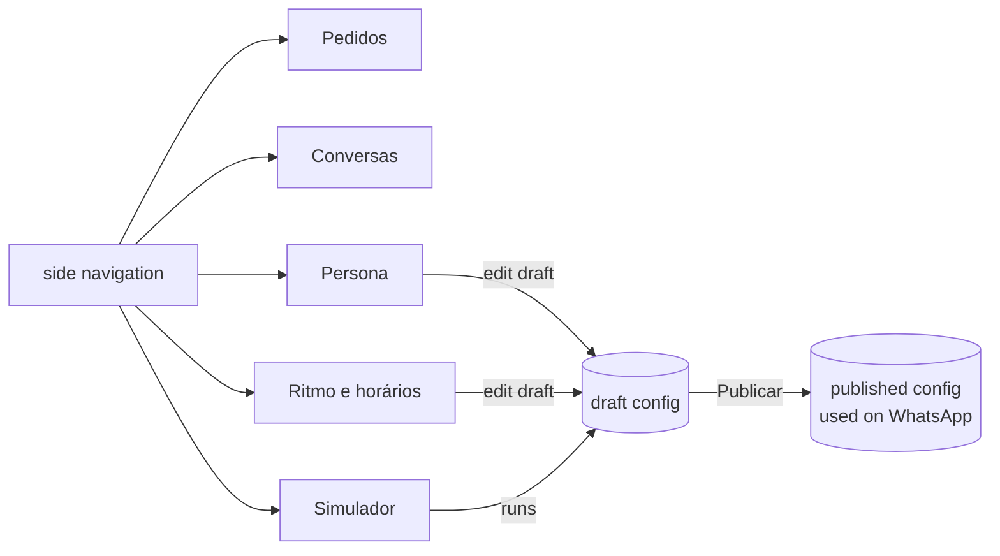

# Architecture — panel

The panel is a single-page app (React + Vite + TypeScript, D-010) served from the same origin as
the backend API. Product decisions and the backend's architecture live in
[`auto-msg-backend`](https://github.com/alexandreluchetti/auto-msg-backend): `docs/decisions.md`,
`docs/ARCHITECTURE.md` (section 12 is the panel) and the ADRs. The API contract is the backend's
`docs/api/openapi.yaml`; `src/api/types.ts` mirrors it.

## Today (M8)

| Area | How |
|---|---|
| Session | HttpOnly cookie set by `POST /api/v1/auth/login`; the panel never holds a token |
| CSRF | `GET /api/v1/auth/csrf` sets `XSRF-TOKEN`; every `POST` sends it as `X-XSRF-TOKEN` |
| Data | `fetch` in `src/api/client.ts`; components refetch what a live event names |
| Live | `EventSource('/api/v1/events')`: `order.*` and `conversation.*` events |
| Screens | Sign-in; orders board with sound alert; last 24 hours; conversations with staff, hand back |

## Humanized service (track H, D-012/D-013, backend ADR-011)

The panel grows from an orders board into the place where a business shapes its assistant:

- **Roles:** `admin` edits persona and human-pace settings and publishes; `staff` sees orders and
  conversations, takes over and hands back.
- **Persona:** name, tone, formality, emojis, typical expressions, greeting/farewell, sample
  replies, with a preview of how a few typical answers read.
- **Human pace and hours:** delays (per character, minimum, maximum), grouping window, messages per
  answer (1–2), the opening-hours message.
- **Simulator:** a WhatsApp-like chat against the draft configuration, with the real assistant and
  tools; bubbles arrive with their delays over SSE; nothing goes to WhatsApp (each message has an
  LLM cost, recorded for the business).
- **Conversations:** list and detail with customer, bot and staff messages told apart, the order in
  progress, take over and hand back.
- **Publishing:** settings are edited as a draft; "Publicar" makes the draft the live version and
  keeps the previous ones.

Conventions stay the same: no UI or state library, accessible roles and labels, tests with a fake
API and EventSource.
